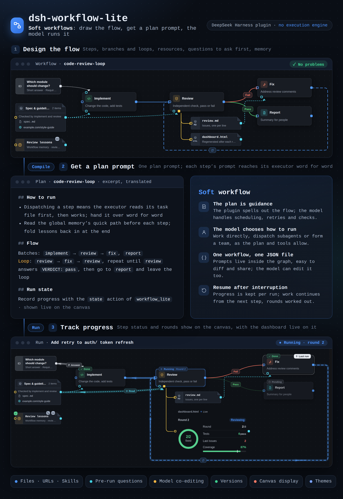
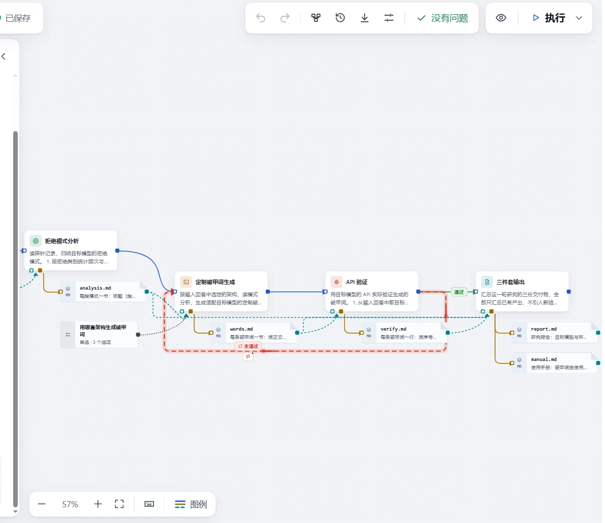
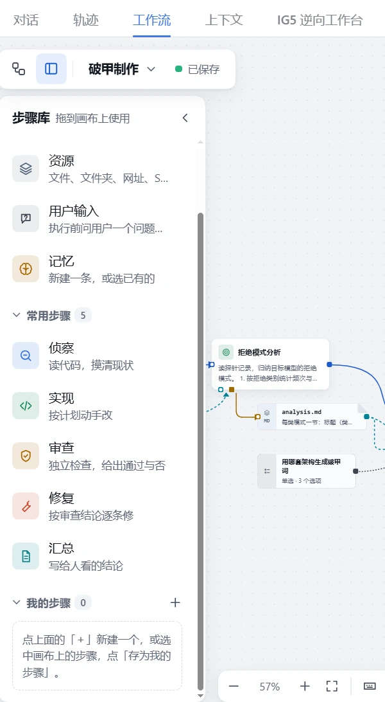

<div align="center">
  <br>
  

**canvas → plan prompt → model execution**

</div>

<div align="center">

[简体中文](./README.md) | English

</div>

<div align="center">

[](https://nodejs.org)
[](https://github.com/deepseek-ai/deepseek-harness)
[](https://github.com/Minglink/dsh-workflows)

</div>

A soft-workflow plugin for [DeepSeek Harness](https://github.com/deepseek-ai/deepseek-harness): **design a flow on a canvas, compile it into one plan prompt, and let the model carry it out.**

Edges can carry **any condition**, and flows can be sequential, parallel, joined, conditionally branched, looped or rolled back — the plugin ships no execution engine; everything is done by the model in your current session.

> [!TIP]
> **Workflow packs**: [Minglink/dsh-workflows](https://github.com/Minglink/dsh-workflows) — ready-to-import `.wflite.zip` workflow packs; the "破甲制作" research pipeline is already up (see [📋 Available workflows](#-available-workflows) below).

> [!NOTE]
> **Experimental**: features and data formats are still changing, and any release may include breaking changes.



## 📋 Available workflows

Ready-made workflows live in the [Minglink/dsh-workflows](https://github.com/Minglink/dsh-workflows) collection. Download a `.wflite.zip` and import it from the **Workflow hub**.

| Workflow | What it does | Download |
|---|---|---|
| **破甲制作** | Automated LLM jailbreak-research pipeline, 15 steps: **probe testing** (200+ probes across identity-system / hybrid-frame / lightweight architectures) → **refusal-pattern analysis** → **tailored jailbreak-prompt generation** → **API verification** → **three deliverables** (jailbreak prompts + usage manual with frame matrix and push-back prompt library + research report). Ships with the `jailbreak-research` Skill: 10 test scripts + 4 prompt templates | [破甲制作.wflite.zip](https://github.com/Minglink/dsh-workflows/raw/master/workflows/破甲制作.wflite.zip) |

## 🖼️ Example workflow

The "破甲制作" research pipeline on the canvas — 15 steps chained into one flow, with branches, loops and output files drawn right on the graph.


<table>
  <tr>
    <td></td>
    <td></td>
  </tr>
</table>

## 📦 Install

Works with DeepSeek Harness 0.2.0 and 0.2.1, including their preview builds (such as 0.2.1-rc.2).

### Web

Requires Node.js 22 or later.

```bash
dsh plugin --profile web add @xiaoso/dsh-workflow-lite
dsh web
```

### Desktop

1. Open **Plugins** in the sidebar, then click **Add plugin** → **Install a third-party plugin**.
2. Enter `@xiaoso/dsh-workflow-lite` and click **Install**.
3. Restart DeepSeek Harness.

Once installed, a **Workflow** tab appears at the top of the session page.

## 🚀 Usage

### Ask the model

Describe the flow in one sentence in the conversation, for example:

> Create a workflow: write the code, then review it; if the review fails, go back and fix it, at most three rounds.

The model creates the workflow and the canvas shows it as it is built. When it looks right, click **Run** in the top-right corner, or ask the model to run it.

### Edit by hand

1. Open the **Workflow** tab and create a workflow.
2. Drag steps from the library on the left onto the canvas, fill in their prompts, and connect them.
3. Click **Run** in the top-right corner, or ask the model in the conversation to run the workflow.

### Follow progress

Turn on **Record run state** in **Workflow settings**. Every run then leaves a record and the canvas updates as the model works. Run records, workflows and versions are managed in the **Workflow hub**, opened from the top-left corner of the canvas.

## 🧩 Features

| Feature | Description |
|---|---|
| 🎨 Canvas editing | Drag steps and connect them, with pass / fail branches and loops; tidy the layout in one click |
| 📎 Resources | Attach files, folders, URLs or Skills that a step reads or writes |
| 💬 Pre-run questions | Collect the information a run needs from the user; answers are passed to the model with the plan |
| 🤖 Model co-editing | The model can create and edit workflows directly, and the canvas updates live |
| 📊 Run state | Progress appears on the canvas as it happens; read each step's summary, adjust its state, and the model is notified |
| 🖥️ Canvas display (beta) | Dashboards, images, documents, logs, tables and folders show right on the canvas and update during a run; review and compare each round of a loop |
| 👁️ File preview | Open a run's resources in place: Markdown, HTML pages (make one a dashboard updated every round to follow a loop's output), images; browse folders in a two-pane view |
| 🕘 Versions | Save versions with notes, compare differences, switch back at any time |
| 📦 Import / export | Pack a workflow and the versions you pick into one `.wflite.zip`, optionally with the files and Skills it uses; before importing, see where each item will go |
| 🧩 Export as a Skill | Compile one version into a skill (SKILL.md, a task description per step, plus the files and Skills you pack) that works without the plugin; download a zip or install it straight into `~/.agents/skills` |
| 🧠 Memory (beta) | A workflow keeps what worked and its pitfalls as a skill and follows it on the next run; manage and version it on the **Memory** page, and export it with a workflow pack |
| 🏛️ Workflow hub | One place for run records across sessions, all workflows and their versions, and plugin settings |
| 🌗 Interface | Four light and four dark color themes that follow DSH light or dark mode; English / 中文 |

## 📁 Path variables

Resource paths and the output root accept two variables, replaced with real locations at run time:

| Variable | Where | Becomes |
|---|---|---|
| `{workflow}` | File and folder paths in resources, e.g. `{workflow}/refs/notes.md` | The workflow's own folder (by default `~/.dsh/workflow-lite/assets/<workflow name>/`). Every workspace reads and writes the same copy, and it moves with the workflow when you rename or export it |
| `{instance}` | **Output root** in **Workflow settings**, same as the default `.workflow-lite/runs/{instance}/out` | The id of this run's instance, so each run keeps its outputs apart |

Paths written as `{assets}/…` by earlier versions still work and become `{workflow}/…` when the workflow is opened.

## 🧪 Experimental features

These features are still being tried out, and their behavior and data formats may change. Besides workflow memory, there is **Canvas display** in the feature table above.

### Workflow memory

Lets a workflow keep what worked and follow it on the next run, with the aim of speeding up complex workflows.

- **Use it**: turn it on for a step, or drag **Memory** from **Basics** in the step library onto the canvas as one shared by the whole workflow; pick an existing entry or create a new one when you add it.
- **Content**: an entry is a skill folder, and the "Quick path" at its top is the cheapest way to do the task next time. Each step reports what it learned in its reply, and when the workflow ends the model folds that in.
- **Manage it**: view and version entries on the **Memory** page in the workflow hub; choose whether to include them when you export.
- **Limits**: instances running at the same time that change the same memory are not locked, so the later write overwrites the earlier one; re-exporting a Skill over an installed copy overwrites the memory it has built up.

Memory is only a configuration shortcut. For anything more elaborate, build it yourself with a resource plus prompts.

**We are still checking whether it helps, and we'd like your feedback.** In early trials that repeated one workflow, we saw no steady speedup; the "Quick path" was added afterwards, and whether it helps needs more real workflows to tell.

## ⚙️ How it works

1. **Design**: arrange steps on the canvas, write the prompt each executor receives, and describe the flow with branches and loops.
2. **Compile**: the plugin turns the workflow into one plan prompt that states the order of work, loop conditions, and each step's inputs and outputs.
3. **Run**: the model decides how to carry out the plan (working directly, dispatching subagents or forming a team) and reports progress back to the canvas.

The plugin ships no execution engine and needs no extra service; scheduling and judgement stay with the model in your current session.

---

<div align="center">

**dsh-jailbreak-workflow** · canvas → plan prompt → model execution

[Workflow packs · dsh-workflows](https://github.com/Minglink/dsh-workflows) · maintained by [MingLin](https://github.com/Minglink)

</div>
